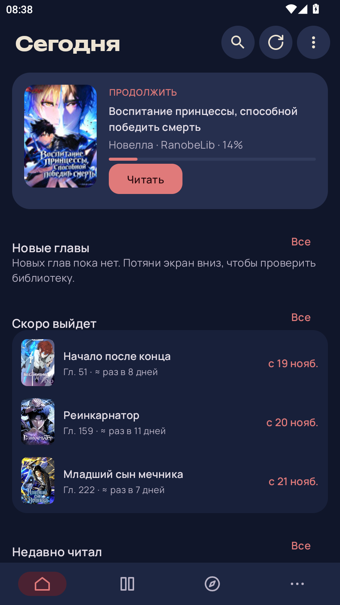
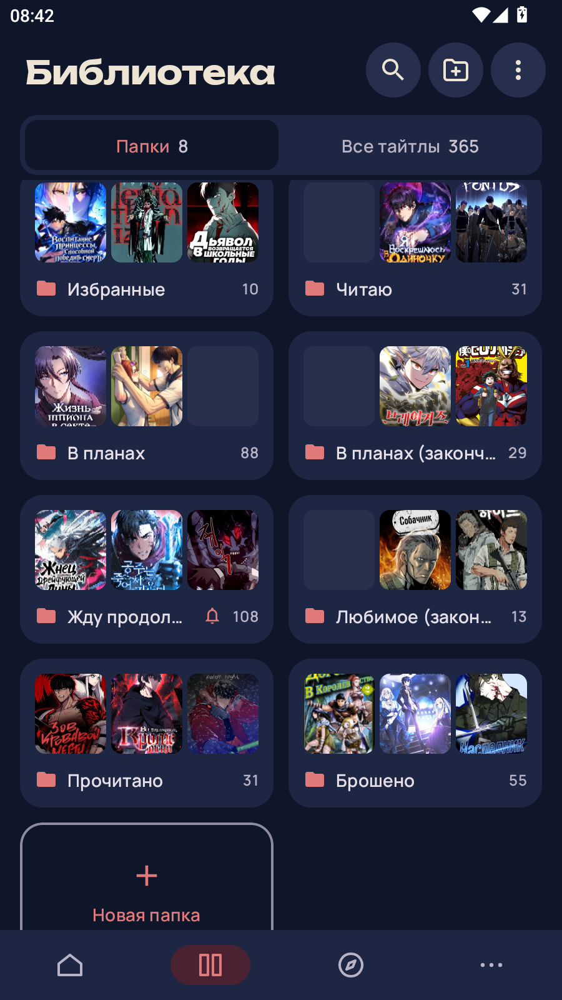
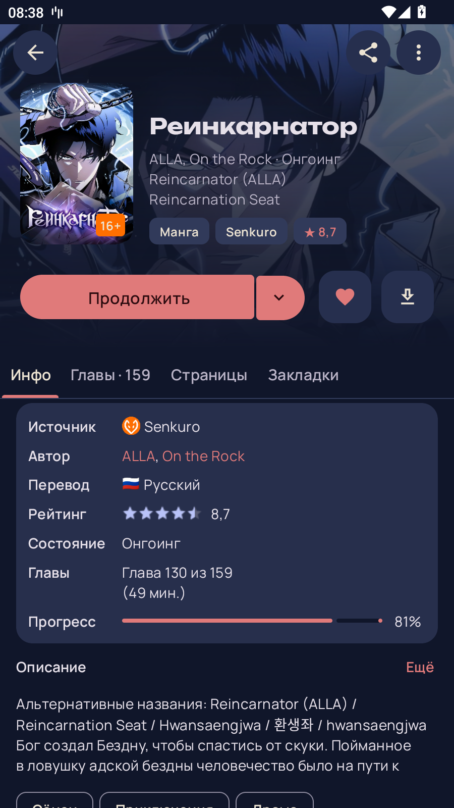
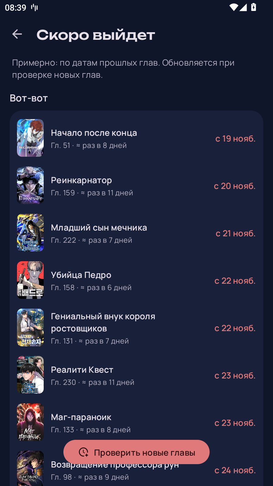
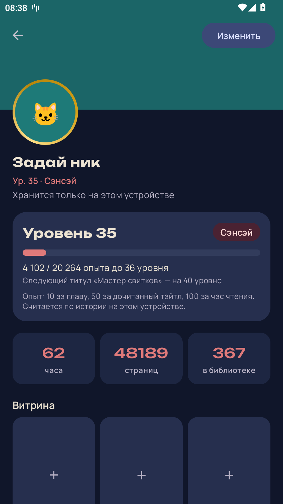

<div align="center">

# Hanten — манга, манхва и ранобэ для Android

**Версия 3.0 — новый интерфейс • Без рекламы и аккаунтов • Обновления прямо из GitHub Releases**

*Вырос из [Kotatsu](https://github.com/KotatsuApp/Kotatsu) и [Futon](https://github.com/AppFuton/Futon) — спасибо им, подробности в разделе [«Благодарности»](#благодарности).*

**В приоритете — поддержка русскоязычных и украиноязычных источников, но чиним и остальные: пользуетесь — пишите, поможем всем.**

*Priority is RU/UK sources, but other languages are welcome too: report a broken source and we'll take a look.*

**Сайт приложения: [dezfix.github.io](https://dezfix.github.io)**


[](https://github.com/DezFix/hanten-parsers)
[](https://github.com/DezFix/Hanten/blob/devel/LICENSE)
[](https://github.com/DezFix/Hanten/releases/latest)

</div>

### Что нового в 3.0

Интерфейс собран заново: вкладка «Сегодня», библиотека с цветными папками, новый каталог, карточка тайтла,
обе читалки, «Ещё» с профилем и настройки карточками. Все функции 2.x на месте, бэкапы 2.x открываются в 3.0.
Полный список — в [CHANGELOG](./CHANGELOG.md).

### Основные возможности

<div align="left">

* **«Сегодня»** — продолжить чтение, новые главы, «Скоро выйдет» (примерная дата следующей главы) и недавнее на одном экране
* Онлайн-[каталоги манги и ранобэ](https://github.com/DezFix/hanten-parsers) — 130+ русских и украинских источников (Senkuro, Реманга, MangaLib, RanobeLib и другие), а также источники на других языках
* Поддержка расширений [Tachiyomi keiyoushi](https://github.com/keiyoushi/extensions)
* Библиотека с цветными папками, фильтрами «Читаю», «Не начато», «Дочитано», по типу и статусу, прогресс на каждой обложке
* Поиск по названию, жанрам и фильтрам, «Похожее» и альтернативные источники для тайтла
* Читалка манги (обычный режим и вебтун, жесты) и читалка ранобэ с темами и озвучкой в фоне
* Скачивание глав для чтения офлайн, сторонние CBZ-архивы
* Уведомления о новых главах, умные обновления (можно пропускать завершённые и не начатые тайтлы)
* Профиль: уровень за чтение, титулы, достижения, статистика
* Трекеры: Shikimori, AniList, MyAnimeList, Kitsu
* Переезд из других приложений: бэкапы Mihon / Tachiyomi (`.tachibk`), Kotatsu и Futon
* История, закладки, режим инкогнито, защита паролем / отпечатком
* Темы, акцентный цвет, скругление углов, порядок вкладок нижнего меню
* Android 6.0+

</div>

### Установка и разработка

#### Что нужно

- **JDK 17** (рекомендуется дистрибутив [Temurin](https://adoptium.net/temurin/releases/))
- **Android SDK** (compile SDK 36, build tools 36.0.0, minimum SDK 23)
- **Android Studio** (рекомендуется) или инструменты командной строки Android SDK

#### Сборка проекта

1. **Клонировать репозиторий:**
   ```bash
   git clone https://github.com/DezFix/Hanten.git
   cd Hanten
   ```

2. **Собрать debug APK:**
   ```bash
   ./gradlew assembleDebug
   ```
   Результат: `app/build/outputs/apk/debug/app-debug.apk`

3. **Собрать release APK:**
   ```bash
   ./gradlew assembleRelease
   ```
   Результат: `app/build/outputs/apk/release/app-release.apk`

   *Примечание: нужна настройка подписи через переменные окружения или `local.properties`*

Подробные правила участия — в [CONTRIBUTING.md](./CONTRIBUTING.md).

### Скриншоты

<div align="center">
    
    
    
    
    
    
</div>

<br>

<div align="center">
    
    
</div>

### Как помочь проекту

Pull request'ы приветствуются. Правила — в [CONTRIBUTING.md](./CONTRIBUTING.md).

### Отпечатки сертификата

```plaintext
D3:F2:AB:2D:82:AF:A0:AB:02:D5:F6:83:98:26:84:7D:85:0B:39:F8:02:65:77:7D:EB:DE:AB:E6:79:E3:CC:67
```

### Лицензия

[](http://www.gnu.org/licenses/gpl-3.0.en.html)

<div align="left">

Вы можете копировать, распространять и изменять программу при условии отслеживания изменений/дат в исходных файлах. Любые модификации или ПО, включающее (через компилятор) код под лицензией GPL, также должны распространяться под GPL вместе с инструкциями по сборке и установке.

</div>

### Отказ от ответственности (DMCA)

<div align="left">

Разработчики приложения не связаны с контентом, доступным в приложении, и не хранят и не распространяют контент. Приложение следует рассматривать как веб-браузер: весь контент, который можно найти с его помощью, свободно доступен в интернете. Все запросы на удаление по DMCA следует направлять владельцам сайтов, на которых размещен контент. Полная позиция проекта — в [docs/LEGAL.md](docs/LEGAL.md).

</div>

---

### Благодарности

<div align="left">

Hanten — самостоятельное приложение, но оно не появилось бы без чужой открытой работы. Спасибо:

* **[Kotatsu](https://github.com/KotatsuApp/Kotatsu)** (Koitharu и участники) — основа приложения: библиотека, читалка,
  загрузки, трекеры, встроенные парсеры. Большая часть кода Hanten начиналась здесь
* **[Futon](https://github.com/AppFuton/Futon)** — форк Kotatsu, из которого пришли читалка ранобэ и ряд улучшений
* **[Mihon](https://github.com/mihonapp/mihon)** и **Tachiyomi** — идеи интерфейса, API расширений и формат бэкапов
  `.tachibk`, благодаря которому из них можно перенести библиотеку
* **[Kotatsu-Redo](https://github.com/Kotatsu-Redo/kotatsu-parsers-redo)** — развитие и поддержка парсеров
* **[Kototoro](https://github.com/Kototoro-app/Kototoro)** — гайд по интеграции расширений Tachiyomi
* **[keiyoushi](https://github.com/keiyoushi/extensions)** — каталог расширений Tachiyomi
* **Переводчикам** Kotatsu и Hanten и всем, кто сообщал об ошибках. Помочь с переводом можно через [GitHub](https://github.com/DezFix/Hanten)

Лицензии и авторство заимствованного кода — в файле [NOTICE](./NOTICE). Hanten распространяется по GPL v3, как и Kotatsu.

Если Hanten тебе полезен, автора можно поддержать на [Ko-fi](https://ko-fi.com/dezfix).

</div>
